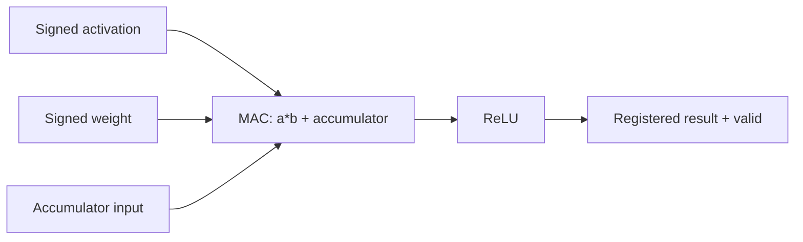

# Architecture

cnn_layer composes the combinational MAC and ReLU. cnn_top registers the layer output when valid_in is asserted and propagates a one-cycle registered valid flag. accumulator.sv is a separate sequential utility and is not integrated into cnn_top. control_fsm.sv and input_buffer.sv are starter modules not yet connected to an end-to-end CNN schedule.
